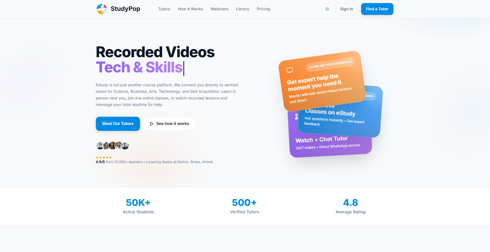

# PropertyPro Zambia



[](https://okeyodev.github.io/proto-company-client-propertyPro-zambia/)
[](https://developer.mozilla.org/docs/Web/HTML)
[](https://developer.mozilla.org/docs/Web/CSS)
[](https://developer.mozilla.org/docs/Web/JavaScript)

**PropertyPro Zambia** is a responsive front-end prototype for an integrated property and investment management platform. It combines a tenant self-service portal with investment dashboards, property portfolios, deal management, compliance, reporting, and operational workflows.

> This repository is a functional UI prototype that uses local mock data. It does not represent a live banking, property, ERP, or investment-management service.

## Live Website

**[Open the live website](https://okeyodev.github.io/proto-company-client-propertyPro-zambia/)**

## Project Preview

The screenshot below provides a visual preview of the interface included with the project:


## Key Features

### Tenant and Property Management

- Tenant dashboard with lease, unit, rent, and outstanding-balance summaries
- Lease and property details
- Invoice, payment, receipt, and utility views
- Maintenance request tracking
- Notices, messages, profile, and settings
- Global search and responsive navigation

### Investment Management

- Executive investment and board dashboards
- Portfolio and asset register views
- Strategic asset allocation versus target allocation
- Property, fixed-income, listed-equity, CIS, unlisted-equity, and cash modules
- Investment deal pipeline and appraisal workspace
- Approvals and conditions-precedent workflows
- Compliance, risk, performance, benchmarks, and report views

### Property-Investment Integration

The prototype uses `propertyId` to connect property records with investment assets. For example, Zambezi Mall is represented consistently in property management and investment views without creating a duplicated property record.

```text
Property record
  -> Operational and tenant data
  -> Investment asset
  -> Portfolio allocation
  -> Performance and board reporting
```

## Technology Stack

- **HTML5** for semantic page structures
- **CSS3** for layouts, design tokens, responsive states, tables, cards, and modals
- **Vanilla JavaScript** for navigation, state management, mock data, calculations, and interactions
- **Browser `localStorage`** for demo state persistence
- **No build tools or third-party runtime dependencies**

## Project Structure

```text
.
|-- index.html                  # Tenant dashboard entry point
|-- Screenshot.png              # Interface preview image
|-- css/
|   |-- common.css             # Shared design system and components
|   |-- layout.css             # App shell and navigation
|   |-- dashboard.css          # Dashboard layouts
|   |-- enterprise.css         # Enterprise and split-pane layouts
|   |-- client.css             # Tenant portal styling
|   |-- investment.css         # Investment platform styling
|   `-- investment-dashboard.css
|-- js/
|   |-- client-common.js        # Tenant data, state, helpers, and search
|   |-- client-layout.js        # Shared navigation and layout engine
|   |-- investment-common.js    # Investment data and calculation engine
|   `-- pages/                  # Page-specific JavaScript modules
`-- pages/                      # Nested application views
```

## Main Application Areas

| Area | Example pages |
| --- | --- |
| Overview | Tenant dashboard, investment dashboard |
| My Tenancy | Lease, unit and property, portfolios, performance |
| Investment Management | Board, asset register, allocation, risk, compliance |
| Property Investments | Property register, property detail, integration view |
| Deal Management | Pipeline, appraisal, approvals, conditions precedent |
| Finance | Payments, invoices, utilities |
| Integration | Development, documents, audit trail, ERPNext mock |

## Getting Started

### Option 1: Open the project directly

Open `index.html` in a modern browser.

### Option 2: Run a local server

For the most reliable navigation and browser behavior, serve the repository with a local HTTP server:

```bash
python -m http.server 5500
```

Then visit:

```text
http://localhost:5500
```

The project can also be opened with VS Code Live Server.

## Demo Data and State

The prototype stores its demo state in browser `localStorage` under:

```text
propertypro_client_v1
```

Other UI preferences, including sidebar state and custom navigation entries, are also saved locally. To reset the demo, clear site data in the browser's developer tools and reload the page.

## Important Prototype Limitations

- Tenant, property, investment, and valuation data is mocked.
- Payment, ERP, ZRA, and bank integrations are demonstrations only.
- Excel, CSV, and PDF actions are UI demonstrations or client-side exports where implemented.
- ERPNext services use mock adapters and do not make live API calls.
- BoZ exchange rates and ZRA invoice checks are mock values.
- No authentication or authorization is implemented.
- Changes are stored in the current browser only and are not shared between devices.
- The screenshot included in this repository is a visual preview and should not be interpreted as a live-data or production-system screenshot.

## Browser Support

The interface is intended for current desktop and mobile browsers, including Chrome, Edge, Firefox, and Safari.

## Future Production Integration

A production version could add:

- Backend and database authentication
- ERPNext, ZRA, mobile-money, and bank integrations
- Role-based access control
- Server-side document storage and versioning
- Real portfolio, valuation, risk, and compliance calculations
- Automated reports and audit logging
- Multi-tenant support
- Deployment and CI/CD workflows

## Repository

- [GitHub Repository](https://github.com/okeyodev/proto-company-client-propertyPro-zambia)
- [Live Demo](https://okeyodev.github.io/proto-company-client-propertyPro-zambia/)

## License

No license has been specified for this repository. All rights remain with the repository owner unless a license is added.
